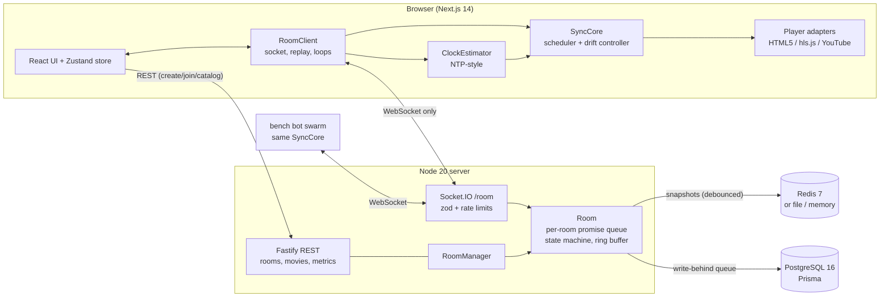
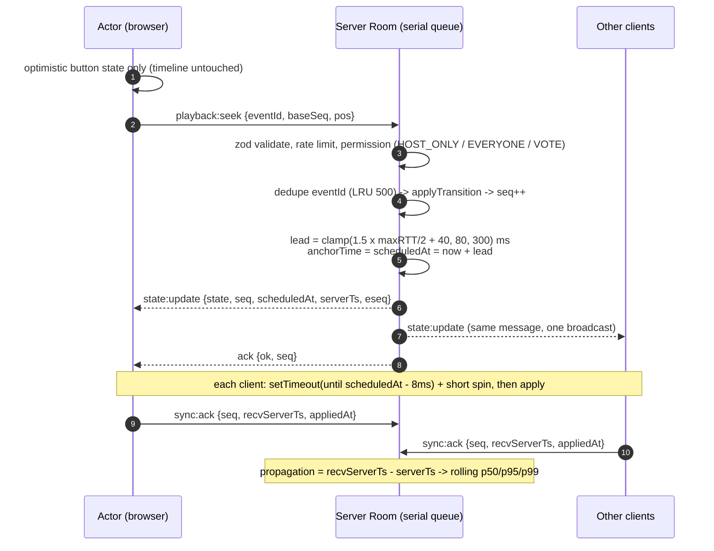
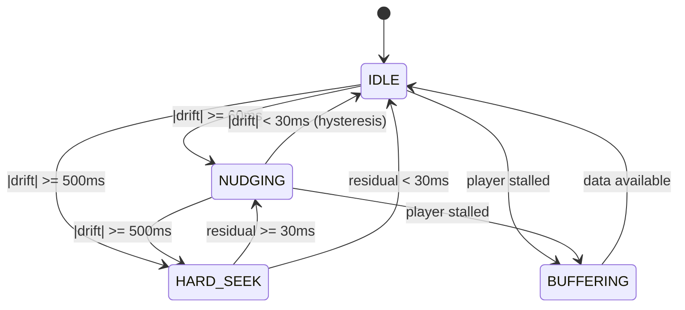
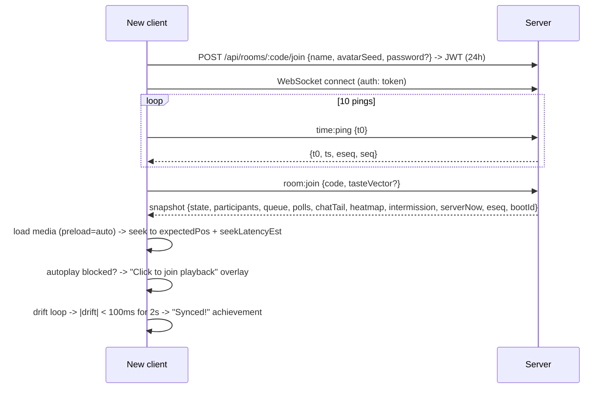

# Architecture

Willio treats synchronized playback as a distributed-systems problem: one authoritative timeline per room,
clients that never stream positions, scheduled execution, and a drift controller that only ever *corrects* toward
the timeline.



## Packages

| Path | What |
| --- | --- |
| `packages/shared` | Types, zod schemas, event names, constants and **all sync math**: `expectedPos`, `applyTransition` (state machine), `ClockEstimator`, `DriftController`, `SyncCore`, fractional indexing, poll tally, Taste Fusion, permission matrix. Used by the server, the browser and the bench bots, so the bench measures the real algorithm. |
| `apps/server` | Fastify REST + Socket.IO. `rooms/Room.ts` is the heart: every mutation runs through a per-room promise chain (total order), every client-visible change is broadcast once with an `eseq` and kept in a 300-event ring buffer. |
| `apps/web` | Next.js App Router UI ("Pixel Glass"), `lib/roomClient.ts` (realtime client), `lib/player/*` (adapters). |
| `bench` | Bot swarm + scenarios S1-S9 + report generator (`docs/LATENCY.md`). |
| `prisma` | Durable schema + migrations. |

## The sync protocol

### Authoritative state

```ts
PlaybackState = { seq, status: PLAYING | PAUSED | BUFFERING, media, rate, anchorPos, anchorTime, updatedBy, ended }
expectedPos(now) = status == PLAYING ? anchorPos + max(0, now - anchorTime) / 1000 * rate : anchorPos
```

Clients never send their position. They receive an anchor and compute where the media *should* be on the
server clock. That makes sync cheap (one message per change) and drift directly measurable.

### Clock sync

On every (re)connect the client sends 10 `time:ping {t0}` 100 ms apart; the server answers `{t0, ts}`.
`rtt = t1 - t0`, `offset = ts - (t0 + rtt/2)`. The 4 lowest-RTT samples give a median offset. Every 5 s one more
ping: accepted only if `rtt <= max(2 x best, best + 8ms)`, smoothed with EMA (alpha 0.2); jumps > 250 ms are ignored
unless confirmed by 3 consecutive samples (sleep/clock change). After 5 slow samples the RTT baseline is reset.
The pong also carries the latest `eseq`, which detects a dropped tail event within 5 s.

### A control action



Because every client applies the change at the same *wall-clock* moment, a packet that arrives 70 ms late still
lands on the intended timeline. Pauses use a shorter lead (<= 60 ms) so they feel instant.
`seq <= latest` updates are ignored (out-of-order guard). If a newer update with a shorter lead arrives before an
older one fires, the older one is skipped when its timer fires.

### Drift control loop (every 500 ms while playing)



- Nudge: `rate = roomRate x (1 - clamp(drift_s x 0.5, -6%, +6%))` with `preservesPitch`.
- Hard seek: to `expectedPos + seekLatencyEst x rate`, where `seekLatencyEst` is an EMA of this device's measured
  seek time (init 120 ms). 2 s cooldown, max 3 per 10 s, then the "Resync me" button lights up.
- YouTube (discrete rates only) skips nudging and hard-seeks above 350 ms.

### Buffering policy

A client whose player is stalled for > 400 ms while the room plays sends `playback:buffering START`.
With `WAIT_FOR_ALL` (default) the server freezes the room (`BUFFERING`, anchor frozen) until every buffering
client sends `END`, or 4 s pass - then it resumes and puts the laggard into **catch-up mode** for 30 s (its future
stalls no longer freeze the room; the drift controller pulls it back). `NEVER_WAIT` never freezes.

### Late join



### Reconnection and reliable delivery

Every client-visible broadcast (`state:update`, chat, queue, polls, participants, host changes, intermission) has
a room-wide `eseq` and is stored in a 300-entry ring buffer.

- A client that sees `eseq != last + 1` (packet drop / chaos) calls `sync:replay {lastEseq, bootId}` and receives
  the missing events in order (or a snapshot if the gap is gone or the server restarted - `bootId` changed).
- On reconnect `room:join` carries `lastEseq` + `bootId`: same rules.
- Socket.IO reconnects with backoff 500 ms -> 8 s + jitter. A heartbeat ping with no pong for 5 s forces a reconnect.
- Chat messages are queued in an outbox while offline and re-sent with the same client id (server dedupes).
- Presence: a dropped participant is shown as "reconnecting..." and removed after 30 s. The same token in a
  second tab replaces the first ("opened elsewhere", latest tab wins).

### Concurrency

- All mutations of a room run through `room.enqueue` (a promise chain) -> one total order; `seq` orders playback.
- Conflicting actions in the same millisecond: arrival order wins; everyone gets the resulting state and a toast
  ("Priya seeked to 12:30").
- Seek scrubbing is preview-only on the client; only the release is sent.
- Idempotency: `eventId` (playback) and client message ids (chat) are deduped in LRUs.
- Queue order uses fractional index keys (no renumbering); reorder references neighbours, a stale reference
  returns `CONFLICT` and the client re-renders from the latest `queue:update`.
- Polls: one vote per (poll, user), changeable until close; ties -> host's vote or random.
- Host transfer vs. host disconnect: both run in the room queue; `hostEpoch` makes the grace-timer succession a no-op
  if anything changed the host meanwhile.

### Host succession

Host disconnects -> 10 s grace -> the longest-connected participant (lowest `joinedAt`) becomes host. Manual
transfer, "request host" (host accepts/denies), and "claim host" when the host is gone are also supported.

## Persistence

| Store | Used for | When absent |
| --- | --- | --- |
| In-memory `Room` objects | the realtime hot path (never waits on I/O) | - |
| Redis 7 (`REDIS_URL`) | `room:{code}:snapshot` (TTL 6 h, saved 200 ms after each mutation + every 2 s), `room:{code}:presence`, `heat:global` | file snapshots in `.data/` (dev) or memory (tests) |
| PostgreSQL 16 (`DATABASE_URL`, Prisma) | rooms, users, participants, messages, reactions, polls + votes, queue, downsampled sync samples, propagation samples, bench runs, movies | writes are skipped; app fully works offline |

Durable writes go through a batched write-behind queue (`db/durable.ts`). If Postgres is down, writes stay
queued (bounded at 20k, oldest append-only rows dropped first) and flush when it returns.

On boot the server restores every room snapshot; participants start "disconnected" with their normal grace
timers, so reconnecting clients slot straight back in.

## Horizontal scale (design)

A room must be owned by exactly one process (its in-memory queue is the source of order). The deployed setup is a
single process, which comfortably handles the target load (see LATENCY.md). To scale out: route sockets by room code
(consistent hash on the code at the load balancer, or the Socket.IO Redis adapter + a Redis lock
`room:{code}:owner` so only the owner node mutates), and restore from the Redis snapshot when ownership moves.

## Security

- zod validation of every REST body and socket payload; per-user/per-event fixed-window rate limits.
- Server-side permission checks for every mutation (host / mod / viewer x control mode).
- Chat is rendered as text by React (no `dangerouslySetInnerHTML`); links are re-parsed and only `http(s)` get an
  anchor with `rel="noopener noreferrer nofollow ugc"`; bidi/zero-width characters are stripped server-side.
- Room codes from `crypto.randomInt` over a 32-char alphabet (~1e9 codes), optional bcrypt password, max users.
- Signed JWT guest sessions (HS256, 24 h); no email or PII.
- Helmet headers, CORS + WebSocket origin allowlist (`CORS_ORIGIN`).
