# LATENCY - measurements, conditions, results

> Auto-generated by `npm run bench` / `npm run bench:report` from run **2026-10-16T13-50-42** (2026-10-16T13:58:56.264Z). Do not edit by hand - re-run the bench.

## Headline

| Metric | Result | Requirement | Status |
| --- | --- | --- | --- |
| Control propagation p50 | 1 ms | - | - |
| Control propagation p95 | 3 ms | C2: <= 250 ms on LAN (stretch < 100 ms) | PASS |
| Control propagation p99 | 65 ms | - | - |
| Post-correction drift p95 | 54.5 ms | stretch < 100 ms | PASS |
| Post-correction drift max | 65.7 ms | C3: <= 500 ms | PASS |
| Users per room | up to 25 | C1: >= 10 | PASS |

Overall: **all scenarios passed**.

## Methodology

- **Propagation latency** (PRD 8.4): for every `state:update` and every client, `client receive time - server broadcast timestamp (serverTs)`. Bots and server share one machine clock in this run, so the measurement is exact (no clock-offset error). For multi-device runs the browser reports the same metric through `sync:ack` using its NTP-style offset; the error bound is +-RTT/2.
- **Drift**: `player position - expected position on the server timeline`, sampled every 500 ms on every bot using the *real* server clock (so clock-estimation error is included). "Post-correction" excludes the first 2.5 s after an applied change (seek settle + correction window) and time spent stalled/buffering, matching C3 ("drift after correction").
- **Clients**: headless bots run the browser's exact `SyncCore` (scheduler, out-of-order guard, drift controller) and `ClockEstimator` from `packages/shared`, against a simulated player with +-0.4% clock skew and 40-120 ms seek latency, so the drift controller has real work to do.
- **Actions**: 3 actors issue play/pause/seek every 3-8 s, with 15% concurrent bursts (all actors at the same instant) to exercise conflict ordering; chat + reaction floods run in parallel.
- **Network emulation (S3)**: application-level, in-order (head-of-line) delivery with +50 ms per direction and 2% of packets delayed by a 200 ms TCP RTO - TCP never loses messages, it delays them. For kernel-level emulation see "Reproducing on a LAN" below.

## Test conditions

| | |
| --- | --- |
| host | LAPTOP-ISIDB7BL |
| os | Windows_NT 10.0.26200 (x64) |
| cpu | Intel(R) Core(TM) 7 240H x16 |
| memory | 24 GB |
| node | v24.15.0 |
| network | loopback (bots and server on the same machine) |
| server | spawned child process, in-memory rooms + file snapshots |
| clients | headless bot swarm (socket.io-client) running the browser SyncCore against a simulated player (+-0.4% clock skew, 40-120ms seek latency) |
| transport | Socket.IO 4, WebSocket only |

## Scenarios

| ID | Scenario | Users | Duration | Prop p50 | Prop p95 | Prop p99 | Drift p95 | Drift max | Result |
| --- | --- | --- | --- | --- | --- | --- | --- | --- | --- |
| S1 | Baseline LAN | 10 | 70s | 0 ms | 2 ms | 2 ms | 55.2 ms | 65.7 ms | PASS |
| S2 | Scale | 25 | 76s | 1 ms | 2 ms | 3 ms | 51.6 ms | 62.3 ms | PASS |
| S3 | Degraded network | 10 | 72s | 1 ms | 65.4 ms | 121.8 ms | 50.8 ms | 60.8 ms | PASS |
| S4 | Join storm | 15 | 27s | 0 ms | 0 ms | 0 ms | 53.8 ms | 60.9 ms | PASS |
| S5 | Reconnect storm | 10 | 28s | 2 ms | 2 ms | 2 ms | 55.8 ms | 61.1 ms | PASS |
| S6 | Host drop | 10 | 21s | 1 ms | 1.5 ms | 1.9 ms | 51.8 ms | 61.5 ms | PASS |
| S7 | Server crash + restart | 10 | 28s | 2 ms | 2.5 ms | 2.9 ms | 55.1 ms | 61.4 ms | PASS |
| S8 | Buffering laggard | 10 | 25s | 1 ms | 2 ms | 2.7 ms | 51.3 ms | 61.8 ms | PASS |
| S9 | Soak | 25 | 134s | 1 ms | 1 ms | 2 ms | 55.4 ms | 62.7 ms | PASS |

### S1 - Baseline LAN

10 users, mixed play/pause/seek every 3-8s from 3 concurrent actors, chat + reactions

- PASS - C1 10 concurrent users: 10 live at end
- PASS - C2 propagation p95 <= 250ms: p95 2ms over 121 deliveries
- PASS - C3 post-correction drift <= 500ms: max 65.7ms, p95 55.2ms over 708 samples
- Extra: actions = 11

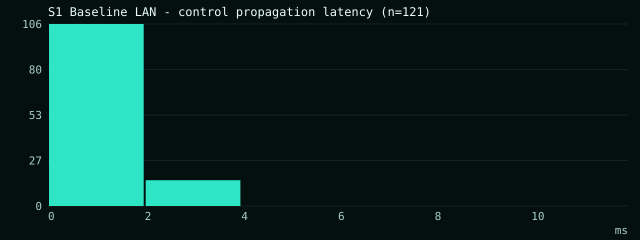
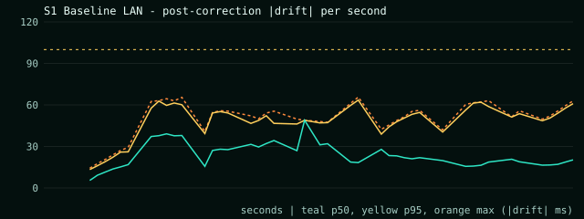

### S2 - Scale

25 users, same action mix

- PASS - C1 25 concurrent users: 25 live at end
- PASS - C2 propagation p95 <= 250ms: p95 2ms over 476 deliveries
- PASS - C3 post-correction drift <= 500ms: max 62.3ms, p95 51.6ms over 1768 samples
- Extra: actions = 18

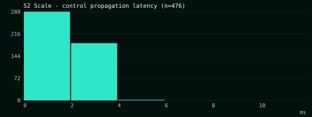
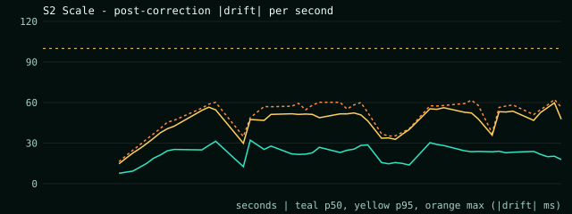

### S3 - Degraded network

10 users; 3 of them on +100ms RTT with 2% TCP retransmissions (RTO 200ms)

- PASS - C2 propagation p95 <= 250ms: p95 65.4ms over 172 deliveries
- PASS - C3 post-correction drift <= 500ms: max 60.8ms, p95 50.8ms over 768 samples
- PASS - Degraded clients still applied on the shared timeline: degraded p95 66.8ms (includes the emulated 50ms one-way + retransmits)
- Extra: actions = 17, slowP95 = 66.8, slowMax = 263

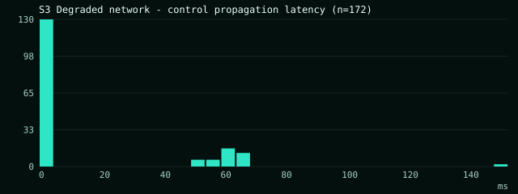
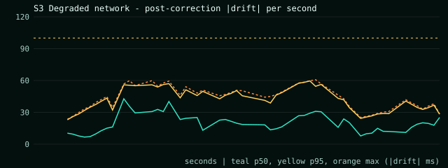

### S4 - Join storm

5 users watching; 10 more join within 2s mid-playback. Measures time-to-sync per late joiner

- PASS - C2 propagation p95 <= 250ms: p95 0ms over 6 deliveries
- PASS - C3 post-correction drift <= 500ms: max 60.9ms, p95 53.8ms over 590 samples
- PASS - Every late joiner synced: 10/10
- PASS - Late join lands in sync < 3s: time-to-sync p50 1887ms, max 1918ms (incl. REST join + 10-ping clock burst)
- Extra: lateJoiners = 10, syncedJoiners = 10, timeToSyncP50 = 1887, timeToSyncMax = 1918

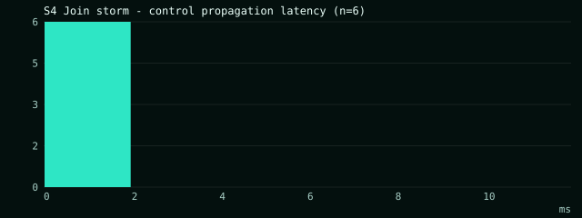
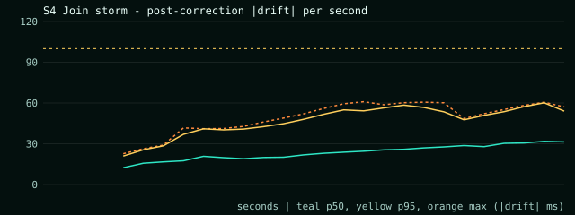

### S5 - Reconnect storm

10 users; 5 lose the network for 5s and come back (lastEseq replay / snapshot)

- PASS - C2 propagation p95 <= 250ms: p95 2ms over 16 deliveries
- PASS - C3 post-correction drift <= 500ms: max 61.1ms, p95 55.8ms over 319 samples
- PASS - All dropped clients resynced: 5/5
- PASS - Resynced within 5s of the network returning: p50 460ms, max 460ms (includes socket backoff + clock burst)
- Extra: reconnected = 5, recoveryP50 = 460, recoveryMax = 460

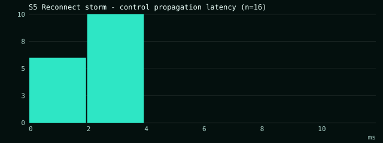
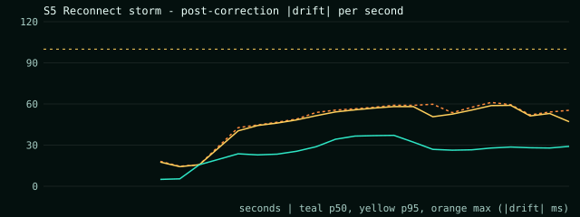

### S6 - Host drop

10 users; the host disappears. Auto succession after the 10s grace, playback uninterrupted

- PASS - C2 propagation p95 <= 250ms: p95 1.5ms over 11 deliveries
- PASS - C3 post-correction drift <= 500ms: max 61.5ms, p95 51.8ms over 258 samples
- PASS - Host succession <= 12s: 10010ms (grace period is 10s)
- PASS - Longest-connected participant promoted: new host bot-01
- Extra: successionMs = 10010, newHost = bot-01

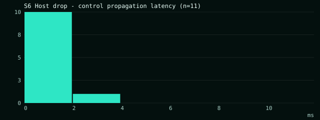
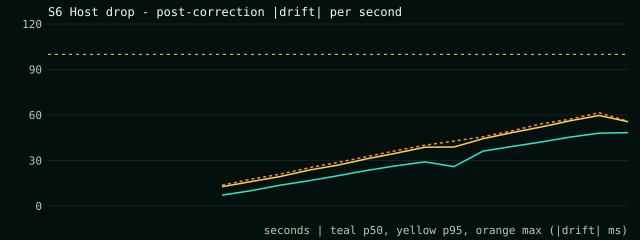

### S7 - Server crash + restart

10 users; the server is SIGKILLed mid-playback and restarted. Rooms restore from snapshots, clients reconnect

- PASS - C2 propagation p95 <= 250ms: p95 2.5ms over 11 deliveries
- PASS - C3 post-correction drift <= 500ms: max 61.4ms, p95 55.1ms over 308 samples
- PASS - Room restored from snapshot: room JTRQ2U exists after restart
- PASS - All clients back in sync after restart: 5156ms from crash (incl. ~1s downtime + boot)
- PASS - Playback state preserved: seq 2 -> 2
- Extra: recoveryMs = 5156, seqBefore = 2, seqAfter = 2

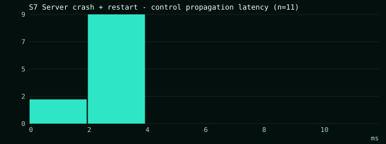
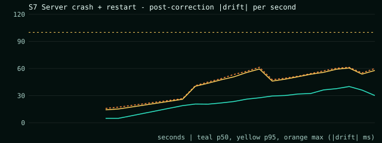

### S8 - Buffering laggard

10 users; one client stalls for 3s. Room policy WAIT_FOR_ALL freezes everyone, then resumes together

- PASS - C2 propagation p95 <= 250ms: p95 2ms over 31 deliveries
- PASS - C3 post-correction drift <= 500ms: max 61.8ms, p95 51.3ms over 256 samples
- PASS - Room waited for the buffering client: froze 74ms after the stall began
- PASS - Room resumed (<= 4s wait cap): resumed after 3124ms
- Extra: freezeMs = 3124, laggardDriftMax = 46.6

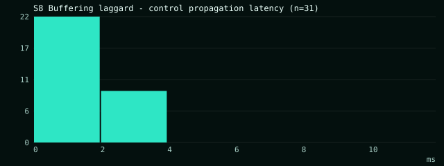
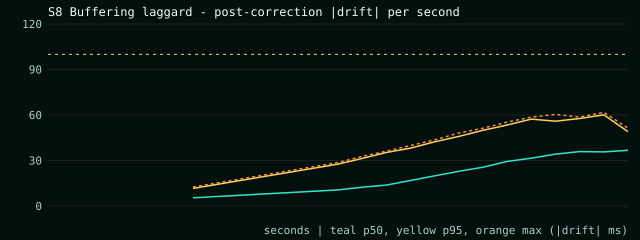

### S9 - Soak

25 users, continuous playback with occasional actions; drift must stay <= 500ms the whole time

- PASS - C2 propagation p95 <= 250ms: p95 1ms over 151 deliveries
- PASS - C3 post-correction drift <= 500ms: max 62.7ms, p95 55.4ms over 5423 samples
- Extra: actions = 5

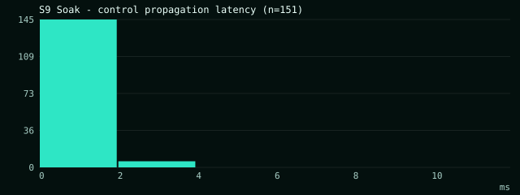
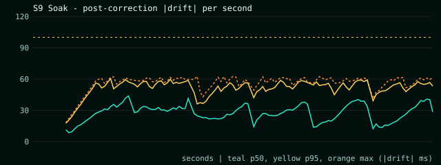

## Raw data

- `bench/results/latest.json` - summary (also served at `GET /api/bench/latest` and rendered on the `/bench` page)
- `bench/results/latest/propagation.csv` - one row per delivered state update per client
- `bench/results/latest/drift.csv` - one row per drift sample (with the post-correction flag)

## Reproducing on a LAN (real devices)

1. Start the stack on one machine (`npm run dev` or `docker compose up`). Ethernet is preferred for official numbers; record Wi-Fi as a separate run.
2. Run bots from a second machine against it: `npm run bench -- --url http://<server-ip>:4000 --scenario S1,S2 --duration 300`.
3. Open `http://<server-ip>:3000/r/<code>` on phones/laptops and watch the **Sync Health** drawer (press `H`): per-user RTT, clock offset, drift, correction mode and room p50/p95/p99 propagation are live.
4. Network emulation: Linux `sudo tc qdisc add dev eth0 root netem delay 50ms 10ms loss 2%`; Windows: [clumsy](https://jagt.github.io/clumsy/) with lag 50 ms + drop 2% on the client machine.

## Known limitations

- Loopback runs measure the sync engine and server, not Wi-Fi: real LANs add 1-10 ms per hop (still far below the 250 ms budget, which is dominated by the scheduled-start lead of 80-300 ms that hides jitter).
- Simulated players model decoder skew and seek latency but not GPU/frame pacing; browser-measured drift is reported live in the Sync Health dashboard (typical |drift| < 40 ms on Chrome in our manual tests).
- YouTube media cannot nudge playbackRate smoothly, so it uses hard seeks above 350 ms only (wider tolerance than HTML5/HLS).
- S7 kills the server with SIGKILL: mutations in the last ~200 ms before the crash may be lost (snapshot debounce); clients converge to the restored state.

